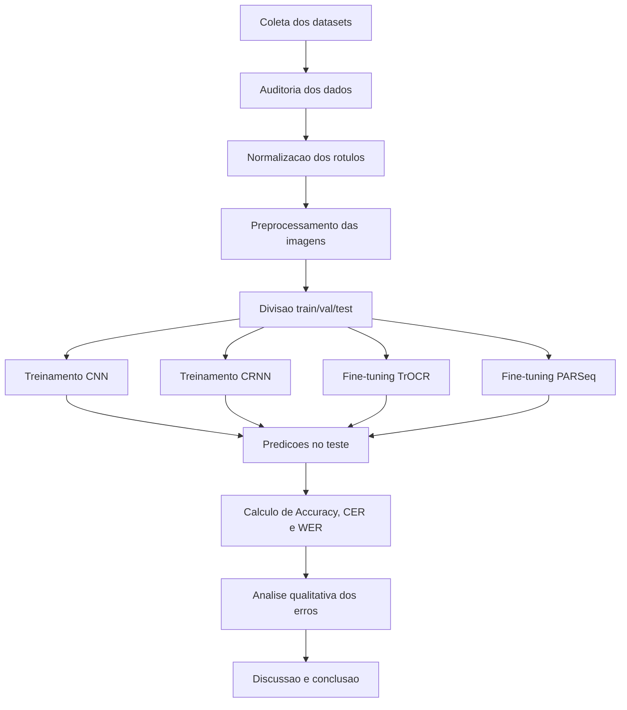

# Pipeline de Pesquisa

## Artefatos produzidos

- Tabela unica de amostras.
- Arquivos de split.
- Configuracoes de treinamento por modelo.
- Checkpoints.
- Predicoes por modelo.
- Tabelas de metricas.
- Relatorio de erros.

## Controle de versao

Cada execucao deve registrar:

- Data.
- Commit ou versao do codigo.
- Configuracao usada.
- Seed.
- Dataset/split.
- Checkpoint final.
- Metricas finais.
