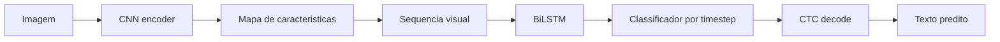

# CRNN (CNN + BiLSTM)

## Papel no estudo

Modelo classico para reconhecimento de texto sequencial, combinando extracao visual por CNN com modelagem temporal por BiLSTM.

## Arquitetura

## Componentes

- CNN: extrai caracteristicas locais da escrita.
- BiLSTM: modela dependencias da sequencia nos dois sentidos.
- CTC Loss: permite treinar sem alinhamento caractere-a-caractere.
- CTC decoding: converte probabilidades em texto.

## Hiperparametros a registrar

- Backbone CNN.
- Altura e largura de entrada.
- Numero de camadas BiLSTM.
- Dimensao oculta da BiLSTM.
- Dropout.
- Vocabulario.
- Learning rate.
- Batch size.
- Beam search ou greedy decoding.

## Pontos de atencao

- A largura da imagem influencia o numero de timesteps.
- Textos muito longos podem exigir largura maior.
- O CTC precisa que a sequencia de entrada tenha comprimento suficiente para representar o rotulo.

## Expectativa

Deve superar CNN baseline em CER/WER quando a tarefa envolver sequencias manuscritas.
