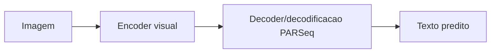

# PARSeq

## Papel no estudo

Modelo Transformer para reconhecimento de texto, usado como alternativa moderna para OCR/HTR e comparacao com TrOCR.

## Arquitetura conceitual

## Decisoes

- Usar checkpoint pre-treinado? A definir.
- Ajustar vocabulario ao dominio medico? A definir.
- Usar decoding padrao do modelo ou beam search? A definir.
- Definir comprimento maximo de texto.

## Hiperparametros a registrar

- Checkpoint inicial.
- Resolucao de entrada.
- Vocabulario.
- Max label length.
- Learning rate.
- Batch size.
- Epochs.
- Augmentations.
- Decoding.

## Pontos de atencao

- PARSeq costuma ser aplicado a reconhecimento de texto em imagem; confirmar compatibilidade com o nivel da tarefa.
- Se as imagens forem prescricoes inteiras, pode ser necessario segmentar linhas/palavras antes.
- Comparar com TrOCR sob preprocessamento e tokenizacao bem documentados.

## Expectativa

Deve ser competitivo em reconhecimento de palavras/linhas, especialmente com pesos pre-treinados e dados bem segmentados.
