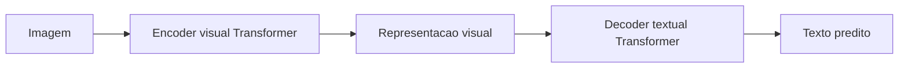

# TrOCR

## Papel no estudo

Modelo Transformer encoder-decoder para OCR/HTR, geralmente beneficiado por pre-treinamento.

## Arquitetura conceitual

## Decisoes

- Usar checkpoint pre-treinado? A definir.
- Fine-tuning completo ou parcial? A definir.
- Tokenizer original ou adaptado? A definir.
- Tamanho maximo da sequencia de saida? A definir.

## Hiperparametros a registrar

- Checkpoint inicial.
- Resolucao de entrada.
- Tokenizer.
- Max target length.
- Learning rate.
- Weight decay.
- Batch size.
- Gradient accumulation.
- Beam size.
- Early stopping.

## Pontos de atencao

- Pode exigir mais memoria que CRNN.
- O tokenizer pode afetar CER/WER.
- Deve-se registrar se letras maiusculas/minusculas e acentos foram preservados.

## Expectativa

Pode apresentar desempenho forte se o pre-treinamento for compativel com manuscritos e se houver fine-tuning suficiente.
